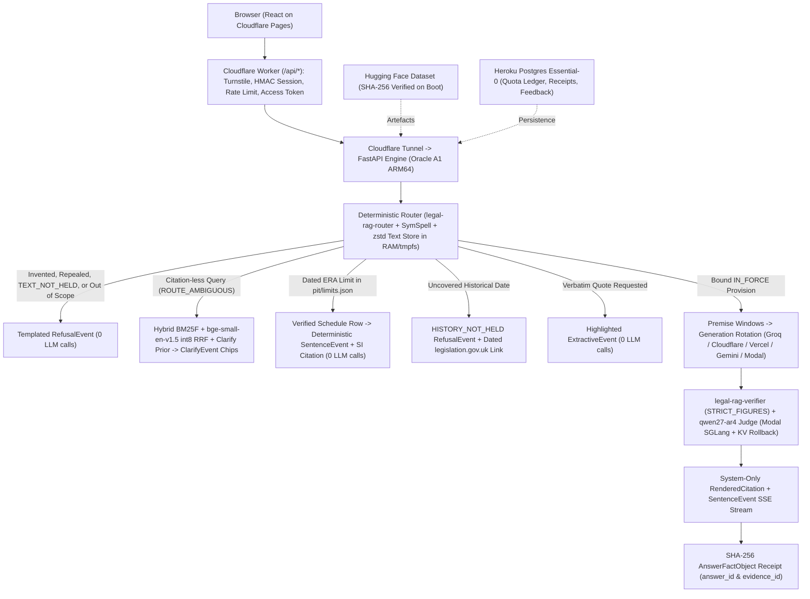

# Chapter & Verse

Chapter & Verse is a grounded UK legislation question-answering web application. Every generated sentence is verified against the underlying statutory text before it streams to the user, citations are rendered solely by the system from bound coordinates, and questions unsupported by held statutes return an explicit refusal.

- **Live app:** https://chapterandverse.memonsystems.com
- **Corpus snapshot:** `2026-09-28` (`134,219` UK instruments — `69,935` full text and `64,284` title-only — `5,564,149` provisions, and `1,322,050` int8 concept vectors resident in `~5.8 GB` RAM on a single Oracle Cloud ARM64 A1 VM, `4 OCPU` / `24 GB`)
- **Packages:** [legal-rag-router](https://pypi.org/project/legal-rag-router/) and [legal-rag-verifier](https://pypi.org/project/legal-rag-verifier/)

## Sealed Measured Results

| Capability | Measured Result | Latency / Footprint | Report |
|---|---|---|---|
| Statutory citation routing | `0/1,897` wrong instruments, `0/68` bound on invented Acts (`2,112`-row UK battery) | `0.14 ms` median | [slice1-gates.md](reports/slice1-gates.md), [sprint5-gates.md](reports/sprint5-gates.md) |
| Citation-less discovery (BM25F + `bge-small-en-v1.5` int8 RRF + clarify prior) | `93.4%` hit@10, `0.719` MRR, `0` phantom candidates, `12/12` fictional refused | `65.7 ms` p50 / `70.4 ms` p95 dense stage on A1 CPU | [sprint5-clarify-sealed.md](reports/sprint5-clarify-sealed.md), [slice3-gates.md](reports/slice3-gates.md) |
| Sentence-level grounding judge (`qwen27-ar4` + `STRICT_FIGURES`) | `99.4%` error catch (`154/155`), `7.3%` false rollback on pass rows (`14/191`), `91.7%` precision | `~1.0 s` p50 on Modal L40S (`69–117 ms` KV rollback) | [heldout-qwen-modal.md](reports/heldout-qwen-modal.md) |
| Legal battery retrieval (sealed 40-row test split) | `38/40` rows passed, `0.947` `must_reach` recall (`38/40`, `0.956` on dev) | Sub-10 ms retrieval | [sprint5-gates.md](reports/sprint5-gates.md) |
| Security & prompt-injection probes (`rag-security-probes`) | `29/29` passed locally and live, `0` generated sentences on adversarial probes | Edge + engine enforcement | [probes-resilience.md](reports/probes-resilience.md), [sprint5-gates.md](reports/sprint5-gates.md) |
| Dated ERA statutory limits (16 Increase of Limits Orders, `SI 2010/2926`–`SI 2026/310`) | `48` SHA-256 verified rows (e.g. `£68,400` as at `2012-01-01`, `SI 2010/2926`) | `174 us` table lookup, `0` LLM calls | [pit_limits.py](engine/chapterverse/pit_limits.py) |

## Live Architecture



## What Failed in Testing

- **DeBERTa NLI verifier:** Caught `80.0%` (`124/155`) of synthetic errors on the sealed held-out set (`53.6%` for deterministic claim checks alone) vs `99.4%` (`154/155`) for the Qwen judge ([heldout-qwen-modal.md](reports/heldout-qwen-modal.md), [judge-gate-2026-11.md](reports/judge-gate-2026-11.md)). Replaced by `qwen27-ar4`.
- **ColBERT reranking (`answerai-colbert-small-v1`, top 24):** Dropped dev discovery accuracy to `0.866` hit@10 and `0.635` MRR (worse than both RRF `0.929` and BM25F `0.902`) while adding `1.35 s` p50 / `2.06 s` p95 CPU latency ([slice3-gates.md](reports/slice3-gates.md)). Kept off.
- **Narrowed judge contexts (cited windows only / cited sections only):** Both failed pre-registered sealed gates by increasing false rollbacks on grounded paraphrases (`24/191` and `18/191` vs `14/191` all-candidates baseline) ([heldout-qwen-modal-cited.md](reports/heldout-qwen-modal-cited.md), [heldout-qwen-modal-section.md](reports/heldout-qwen-modal-section.md)). Production keeps all candidate windows (`STRICT_FIGURES`).
- **Modal judge run-to-run variance:** `8/261` byte-identical prompts flipped labels between runs at `temperature=0.7, seed=0` (`4` verdict changes) ([heldout-qwen-modal-section.md](reports/heldout-qwen-modal-section.md)). Any future judge change requires a same-day control run.
- **Cloudflare-first judge ordering:** Increased provider-limit incomplete notices and raised median answer latency from `5.3 s` to `9.4 s` ([sprint5-gates.md](reports/sprint5-gates.md)). Reverted.

## Current Limits

- **Statutory coverage:** Holds current UK legislation as at `2026-09-28` plus 16 Employment Rights (Increase of Limits) Orders (`2011`–`2026`) for ERA 1996 sections 124, 186, and 227; other historical `as_at` queries return `HISTORY_NOT_HELD` with a dated `legislation.gov.uk` link.
- **Title-only instruments:** `64,284` instruments hold metadata only and return `TEXT_NOT_HELD` with an official link.
- **Scope exclusions:** No case law, tribunal decisions, regulatory guidance, or document uploads.
- **Single-turn:** Multi-turn Postgres session persistence is not yet enabled; each request routes and verifies independently.

## Repository Layout

| Path | Contents |
|---|---|
| `engine/chapterverse/` | FastAPI app, pipeline, dense & clarify discovery, verified PIT limits, providers, audit/verification, and Postgres persistence |
| `build/` | Write path for the packed zstd text store, SymSpell dictionary, dense index, and Hugging Face dataset publisher |
| `web/` | React + TypeScript frontend deployed to Cloudflare Pages |
| `deploy/` | Dockerfiles, `entrypoint.sh`, SHA-256 artefact fetcher, Cloudflare Worker (`/api/*`), Modal judge server, Oracle setup, and schema |
| `eval/` | Gate runners for router accuracy, discovery, legal answers, judge calibration, and security probes |
| `reports/` | Sealed benchmark reports and pre-registrations |
| `scripts/receipt.py` | Read-only CLI to inspect stored receipts (`answer_id` and deterministic `evidence_id`) and provider quota |
| `docs/ARCHITECTURE.md` | Module map and SSE / `AnswerFactObject` interface contract |

## Development & Verification

```bash
uv sync
uv run ruff check
uv run ruff format --check
uv run mypy
uv run pytest -q
```

Frontend checks:

```bash
cd web
npm ci
npm run typecheck
npm run test
npm run lint
npm run build
```

Tests run against the fixture corpus in `tests/fixtures/`. Tests marked `data` require the full corpus (`LEGAL_DATA_ROOT`).

## Licence

AGPL-3.0-only. See [LICENSE](LICENSE). Legislation data is Crown copyright under the Open Government Licence v3.0. See [NOTICE](NOTICE).
